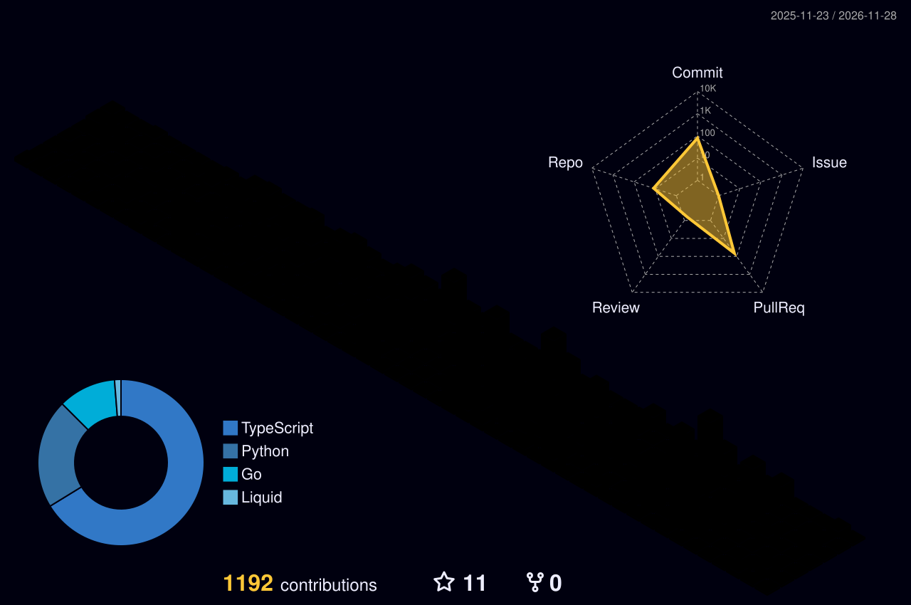

  
  
  
  

## About me

Backend engineer focused on **event-driven architectures** and **distributed systems**. I build REST APIs, real-time streaming pipelines and microservices, mostly in Python and .NET, with Go as my newest language. I'm studying Computer Science at Mansoura University.

- **Building now:** AI-powered backends, from RAG knowledge systems to autonomous agents
- **Core work:** microservices that communicate through Kafka, Celery and Redis, behind REST APIs in Django REST Framework, FastAPI and ASP.NET Core
- **Cloud:** AWS Certified Cloud Practitioner, shipping containerized services with Docker and CI/CD
- **Open to:** backend and distributed-systems roles, and open-source collaboration

## How I build

Define service boundaries, model the events and API contracts, scale out with stateless services and caching, add logging, tracing and metrics, plan for failure with retries and dead-letter queues, then ship with Docker and CI/CD.

## Tech stack

## Featured projects

<table>
  <tr>
    <td width="50%" valign="top">
      <h3><a href="https://github.com/yousefalimansour/rag-knowledge-ops">KnowledgeOps AI</a></h3>
      
RAG knowledge base that ingests documents and team data, answers questions with cited sources, and surfaces proactive insights. Hybrid retrieval with reranking and streamed answers.

      
<code>FastAPI</code> <code>Next.js</code> <code>PostgreSQL</code> <code>Chroma</code> <code>Celery</code> <code>Docker</code>

    </td>
    <td width="50%" valign="top">
      <h3><a href="https://github.com/yousefalimansour/recruiter-agent">AI Recruitment Agent</a></h3>
      
Autonomous job-hunting agent: discovers roles, scores them against a profile, tailors the résumé and cover letter, and applies through the browser with a human in the loop. <a href="https://recruiter-web-one.vercel.app">Live site</a>

      
<code>FastAPI</code> <code>pgvector</code> <code>Playwright</code> <code>n8n</code> <code>Docker</code>

    </td>
  </tr>
  <tr>
    <td width="50%" valign="top">
      <h3><a href="https://github.com/yousefalimansour/Kafka-monitoring-service">Kafka Monitoring System</a></h3>
      
Distributed logging and monitoring built on Apache Kafka: microservices that stream, store and analyze logs in real time.

      
<code>Django</code> <code>Apache Kafka</code> <code>PostgreSQL</code> <code>Docker</code>

    </td>
    <td width="50%" valign="top">
      <h3><a href="https://github.com/yousefalimansour/System-alert">Stock Alert System</a></h3>
      
REST API that tracks stock prices and emails alerts on threshold and duration rules, with background jobs, JWT auth and a pytest suite.

      
<code>Django REST</code> <code>Celery</code> <code>Redis</code> <code>PostgreSQL</code> <code>AWS EC2</code>

    </td>
  </tr>
  <tr>
    <td width="50%" valign="top">
      <h3><a href="https://github.com/yousefalimansour/Ai-image-medical-helper">AI Medical Image Helper</a></h3>
      
Full-stack assistant that helps clinicians review chest X-rays and skin lesions with model inference, doctor-only access and audit logging. An assistance tool, not a diagnostic device.

      
<code>FastAPI</code> <code>React</code> <code>TypeScript</code> <code>PostgreSQL</code> <code>Docker</code>

    </td>
    <td width="50%" valign="top">
      <h3><a href="https://github.com/yousefalimansour/Real-Time-Chat">Real-Time Chat</a></h3>
      
Chat application with live messaging over WebSockets, authentication and multiple rooms, split into focused Django apps.

      
<code>Django</code> <code>WebSockets</code> <code>Python</code>

    </td>
  </tr>
</table>

## Contribution arcade

<picture>
  <source media="(prefers-color-scheme: dark)" srcset="https://raw.githubusercontent.com/yousefalimansour/yousefalimansour/output/pacman-contribution-graph-dark.svg" />
  <source media="(prefers-color-scheme: light)" srcset="https://raw.githubusercontent.com/yousefalimansour/yousefalimansour/output/pacman-contribution-graph.svg" />
  
</picture>

<picture>
  <source media="(prefers-color-scheme: dark)" srcset="https://raw.githubusercontent.com/yousefalimansour/yousefalimansour/output/github-snake-dark.svg" />
  <source media="(prefers-color-scheme: light)" srcset="https://raw.githubusercontent.com/yousefalimansour/yousefalimansour/output/github-snake.svg" />
  
</picture>

Redrawn every day from my real contribution graph by a GitHub Action.

## Credentials

- **AWS Certified Cloud Practitioner**, Amazon Web Services · [Verify credential](https://www.credly.com/badges/8bd1e4b9-1601-481c-ad58-4df72ca33ab3/linked_in?t=slqzdf)
- **B.Sc. in Computer and Information Science**, Mansoura University · 2022 to present

